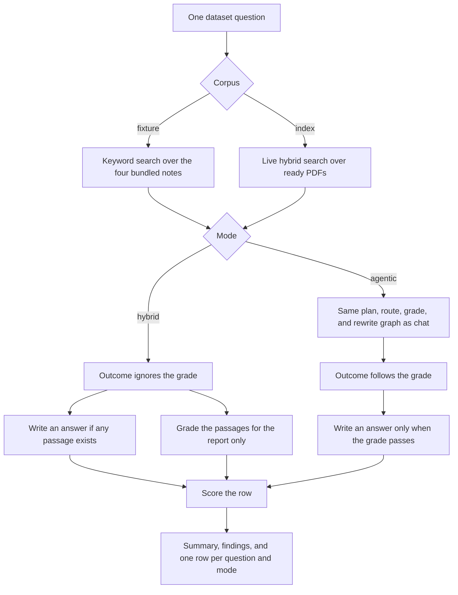

# Evaluation

V5 adds a score for hybrid search versus the retrieval agent, and it changes chat so a failed grade does not produce an answer.

## What changed in the code

The chat path now ends in one of three outcomes, decided in `decideOutcome` in `backend-server/src/services/outcome.ts` and applied in `backend-server/src/routes/chat.ts`.

| Outcome | Condition | What the API returns |
|---|---|---|
| `not_found` | No passage came back | A fixed message. The answer model is not called. |
| `insufficient_evidence` | The agent grade is still false after retries | The same passages as citations, plus a fixed message. The answer model is not called. |
| `answered` | Passages exist and the grade passed, or the agent is off | The cited answer, as before |

The agent trace now keeps two extra fields from each search: `gradeReason`, and `retrievals` (the queries, chunk ids, and scores). Those live on the graph state in `backend-server/src/services/agent/graph.ts` and are copied out by `toTrace`.

Evaluation is a separate path. It does not go through `POST /api/chat`.

| Piece | Role |
|---|---|
| `evaluation/dataset.json` | Six fixed questions: two lookups, two multi-hop, two unanswerable |
| `evaluation/fixture.ts` | Four short notes, ranked by keyword overlap and fused when the agent plans more than one query |
| `evaluation/execute.ts` | Runs one question as hybrid or agentic |
| `evaluation/metrics.ts` | Recall@K, answer quality, sufficiency, retries, and the summary |
| `evaluation/run.ts` | Loops the questions, times each one, and counts model tokens |
| `services/llm.ts` | `trackLlmUsage` counts calls and tokens only while a question is inside that wrapper |
| `routes/evaluation.ts` | `GET /api/evaluation/dataset` and `POST /api/evaluation/run` |
| `pages/EvaluationPage.tsx` | The `/evaluate` page |

`LLM_PROMPT_USD_PER_MILLION` and `LLM_COMPLETION_USD_PER_MILLION` price those tokens. Both default to `0`.

## How a chat question flows

```mermaid
flowchart TD
  question[User question] --> agentOn{AGENT_ENABLED}
  agentOn -->|yes| graph[Plan, route, retrieve, grade, maybe rewrite or a tool]
  agentOn -->|no| hybrid[BM25 plus vectors, then fusion and rerank]
  graph --> decide[decideOutcome]
  hybrid --> decide
  decide --> empty{Any passages}
  empty -->|no| notFound[not_found: fixed message]
  empty -->|yes| grade{Agent grade}
  grade -->|sufficient is false| thin[insufficient_evidence: keep citations, skip the answer model]
  grade -->|sufficient is true, or the agent is off| answer[answered: write the cited answer]
```

Hybrid chat never looks at a grade. If any passage comes back, the outcome is `answered` and the model writes from those passages. The agent path is the one that can return `insufficient_evidence`.

## How an evaluation run flows

`/evaluate` loads the six questions, then `POST /api/evaluation/run` walks them one at a time. Each question is run in hybrid mode, then in agentic mode. Tool calls are turned off for this run, so the score is about retrieval.



On the fixture corpus, search does not use PostgreSQL or the embedding server. It still calls the chat model to plan, grade, and answer. Indexed PDFs uses the normal retriever, so the database and the embedding server have to be up. The labels were written for the four fixture notes, so recall on a different PDF set can be zero.

## How a row is scored

`scoreCase` compares the run with the label on that question.

- **Recall@K** is the share of labeled phrases that show up in the top K passages. The two unanswerable questions have no phrases, so recall is empty for them.
- **Answer quality** on a lookup or multi-hop question is the share of expected facts found in the answer text. On an unanswerable question it is 1 only when the outcome is `not_found` or `insufficient_evidence`.
- **Sufficiency** is whether the outcome agrees with the label about producing an answer. Hybrid still answers whenever a passage exists, so an unanswerable question that retrieved a related note is marked as answered anyway. The report lists that as an unsupported answer. The grade stored on that hybrid row is for the report. It does not change the hybrid answer.
- **Retries** come from the agent trace. A retry that keeps the same chunk ids is called out in the findings.

The page then shows averages by mode and question type, those findings, and the searches, grade, answer, and citations for each row.
