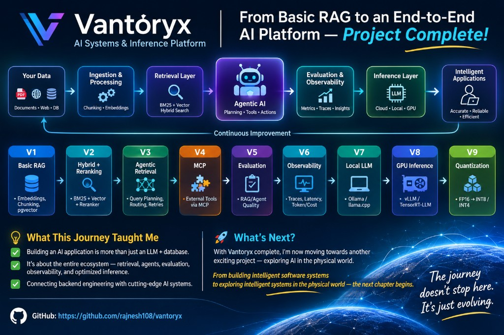

# From basic RAG to an end-to-end AI platform

**Vantoryx — AI Systems & Inference Platform. Project complete.**

## Platform path

Your data moves through one path, and what is learned feeds back as continuous improvement.

1. **Your data.** Documents, the web, and a database.
2. **Ingestion and processing.** Chunking and embeddings.
3. **Retrieval layer.** BM25 and vector hybrid search.
4. **Agentic AI.** Planning, tools, and actions.
5. **Evaluation and observability.** Metrics, traces, and insights.
6. **Inference layer.** An LLM in the cloud, locally, or on a GPU.
7. **Intelligent applications.** Accurate, reliable, and efficient.

## Versions

| Version | What was built | What it shows |
|---|---|---|
| V1 | Basic RAG | Embeddings, chunking, pgvector |
| V2 | Hybrid and reranking | BM25, vector search, and a reranker |
| V3 | Agentic retrieval | Query planning, routing, and retries |
| V4 | MCP | External tools through MCP |
| V5 | Evaluation | RAG and agent quality |
| V6 | Observability | Traces, latency, and token cost |
| V7 | Local LLM | Ollama and llama.cpp |
| V8 | GPU inference | vLLM and TensorRT-LLM |
| V9 | Quantization | FP16 to INT8 and INT4 |

## What this journey taught me

- Building an AI application is more than an LLM and a database.
- It is the whole ecosystem: retrieval, agents, evaluation, observability, and optimized inference.
- Backend engineering connects to the AI systems that run on top of it.

## What's next

With Vantoryx complete, the next project is AI in the physical world.

From building intelligent software systems to exploring intelligent systems in the physical world, the next chapter begins.

The journey doesn't stop here. It's just evolving.

GitHub: https://github.com/rajnesh108/vantoryx
